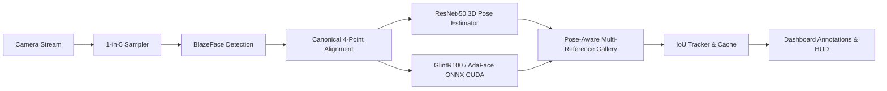

# Real-Time Multi-Camera Face Recognition System

Production-grade, GPU-accelerated face recognition system featuring:
- **BlazeFace (Full Range Sparse)** for high-precision face detection and landmark extraction.
- **Canonical Landmark Face Alignment** with similarity transform ($112 \times 112$) to eliminate in-plane tilt and head roll distortions.
- **ResNet-50 6D Rotation Matrix** for real-time 3D head pose estimation (`Front`, `Left`, `Right`, `Up`, `Down`).
- **Dual State-of-the-Art Embedding Models** with on-the-fly model switching:
  - **GlintR100 (ArcFace ResNet-100)** trained on Glint360K
  - **AdaFace IR-101** trained on WebFace12M with adaptive margin loss
- **Multi-Pose Video Enrollment & Deduplication Engine** with automated "Train" button in dashboard.
- **Section 16 Confidence Calibration & Display Rules** (Green $\ge 90\%$, Yellow $60-89\%$, Red/Unknown $< 60\%$).
- **Live Glassmorphic Web Dashboard** with real-time GPU compute and VRAM HUD metrics.

---

## Architecture Pipeline



---

## Directory Structure

```
Face-recognition/
├── app.py                      # Flask web application entry point & REST APIs
├── config.py                   # Central configuration & path registry
├── requirements.txt            # Python dependencies
├── .gitignore                  # Git ignore rules for models, videos, and caches
├── README.md                   # System documentation & usage guide
│
├── data/                       # Datasets & enrollment assets
│   ├── raw_videos/             # Video files for enrollment (e.g., "Anoop Verma.mp4")
│   └── images/                 # Static enrollment photos (optional)
│
├── gallery/                    # Per-model serialized identity embeddings
│   ├── embeddings_glintr100.json
│   └── embeddings_adaface.json
│
├── models/                     # Deep learning weights (ONNX / TFLite)
│   ├── detection/
│   │   └── blaze_face_full_range_sparse.tflite
│   ├── embeddings/
│   │   ├── glintr100.onnx
│   │   ├── adaface_ir101.onnx
│   │   └── adaface_ir101_webface12m.ckpt
│   └── pose/
│       └── resnet50.onnx       # 6D rotation matrix head pose model
│
├── pipeline/                   # Core modular pipeline
│   ├── camera.py               # Multi-camera threaded acquisition & 1-in-5 sampler
│   ├── detector.py             # BlazeFace TFLite wrapper with landmark decoding
│   ├── embedder.py             # GlintR100 & AdaFace ONNX Runtime inference
│   ├── engine.py               # Orchestration engine & multi-camera workers
│   ├── enrollment.py           # Multi-angle video enrollment & quality deduplication
│   ├── gallery.py              # Pose-aware identity gallery & Section 16 calibration
│   ├── pose_estimator.py       # ResNet-50 3D head pose estimation
│   ├── preprocessor.py         # 4-point similarity transform face alignment
│   └── tracker.py              # IoU-based tracking & identity caching
│
├── static/                     # Web dashboard frontend assets
│   ├── css/
│   │   └── dashboard.css       # Glassmorphism dark UI styling
│   └── js/
│       └── dashboard.js        # Real-time WebSocket/polling, HUD, & model switcher
│
├── templates/                  # Jinja2 templates
│   └── dashboard.html          # Interactive operations dashboard
│
└── tests/                      # Verification & benchmark suites
    ├── benchmark_evaluation.py # Comprehensive comparative evaluation suite
    └── benchmark_results.json  # Exported metrics report
```

---

## Quick Start

### 1. Requirements

Ensure NVIDIA drivers, CUDA, and cuDNN are installed. To install Python dependencies:

```bash
pip install -r requirements.txt
```

### 2. Enroll New Identities from Video

Place `.mp4` video clips in `data/raw_videos/`:
```
data/raw_videos/
├── Anoop Verma.mp4
├── Devanshu Pal.mp4
└── New Person.mp4
```
*Naming rule:* The video filename (without extension) directly becomes the enrolled identity name.

Click the **Train** button in the dashboard or run via API:
```bash
curl -X POST http://localhost:5000/api/train -H "Content-Type: application/json" -d '{"model": "glintr100"}'
```

### 3. Launch Dashboard

```bash
python3 app.py
```
Open **`http://localhost:5000`** in your browser.

---

## Deep Learning Models

| Component | Model Backbone | Format | Input Tensor | Output | Runtime |
|---|---|---|---|---|---|
| **Face Detection** | BlazeFace (Full Range Sparse) | TFLite | `[1, 192, 192, 3]` uint8 | BBoxes + 6 Landmarks | XNNPACK / CPU (~2.5 ms) |
| **Face Alignment** | Similarity Transform | OpenCV | 4 canonical landmarks | `[112, 112, 3]` BGR | CPU (< 0.2 ms) |
| **3D Head Pose** | ResNet-50 (6D Rotation Matrix) | ONNX | `[1, 3, 224, 224]` float32 | `[1, 3, 3]` Rotation matrix | CUDA (~2.1 ms) |
| **Identity Embedding** | GlintR100 (ArcFace ResNet-100) | ONNX | `[N, 3, 112, 112]` float32 | `[N, 512]` L2-normalized | CUDA (~3.4 ms) |
| **Identity Embedding** | AdaFace IR-101 (Adaptive Margin) | ONNX | `[N, 3, 112, 112]` float32 | `[N, 512]` L2-normalized | CUDA (~4.2 ms) |

---

## Section 16 Display Rules & Confidence Calibration

| Confidence | Bounding Box Color | Label Display | Description |
|---|---|---|---|
| **$\ge 90\%$** | **Green** (`#22c55e`) | `<Name> (<Score>%)` | High confidence match |
| **$60\% - 89\%$** | **Yellow** (`#eab308`) | `<Name> (<Score>%)` | Moderate confidence match |
| **$< 60\%$** | **Red** (`#ef4444`) | `Unknown` | Ambiguous / Impostor / Unknown face |

---

## REST API Reference

| Endpoint | Method | Description |
|---|---|---|
| `/` | GET | Operations Dashboard UI |
| `/video_feed/<cam_id>` | GET | MJPEG live camera stream with Section 16 HUD |
| `/api/status` | GET | Live system metrics (FPS, GPU %, VRAM, latency breakdown) |
| `/api/model/switch` | POST | Hot-switch between `glintr100` and `adaface` on GPU |
| `/api/train` | POST | Trigger background video enrollment & embedding generation |
| `/api/train/status` | GET | Progress status of ongoing training jobs |
| `/api/gallery` | GET | Summary of enrolled identities and poses |
| `/api/camera/<id>/start` | POST | Start specified camera worker |
| `/api/camera/<id>/stop` | POST | Stop specified camera worker |
